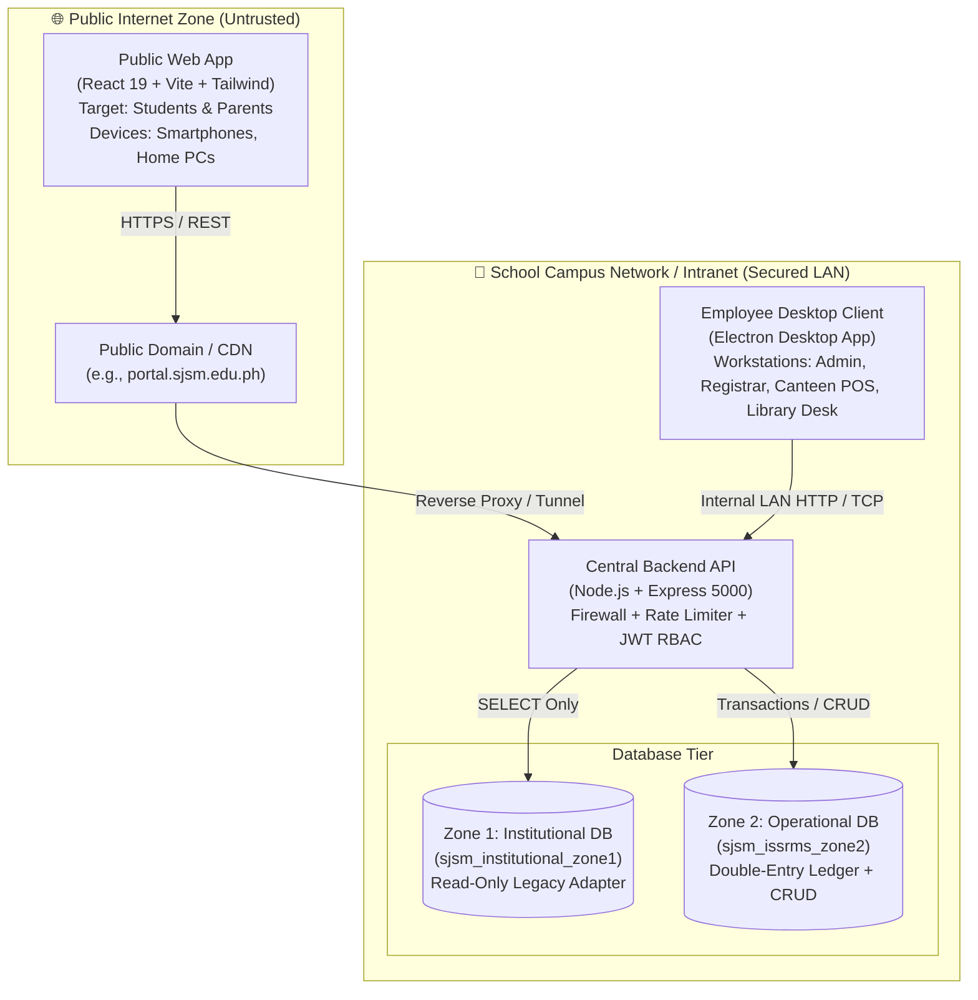
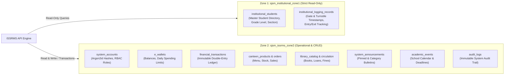
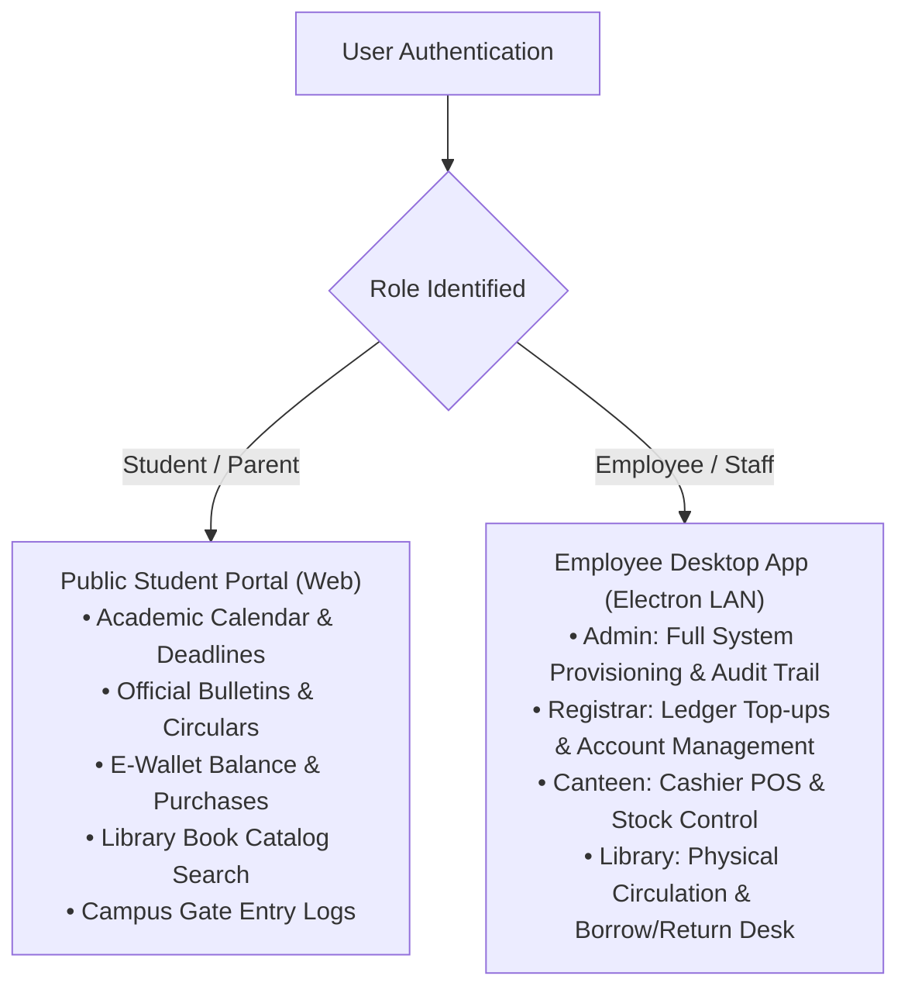

# ISSRMS: Current vs. Future Implementation Architectural Analysis
**Saint Joseph School of Mactan — Integrated Student Services & Resource Management System**

This document details the exact engineering specification, data flow, component boundaries, and deployment roadmap for ISSRMS. It is structured so designers and groupmates can translate the architecture into UI flows, system diagrams, and presentation visualizers.

---

## 1. System Overview & The Split-Boundary Model

ISSRMS uses a **Split-Boundary Architectural Pattern** that separates public student-facing services from high-privilege employee school operations.

---

## 2. Comparison Matrix: Current vs. Future Implementation

| Feature / Domain | Current Implementation (Completed) | Future Implementation (Target Production) |
| :--- | :--- | :--- |
| **Client Hosting** | Monolithic local dev client running on Vite (`:5173`) with mock role switcher. | **Split Clients:** 1. **Public Web**: Bundled for students, hosted on school domain (`portal.sjsm.edu.ph`). 2. **Desktop App**: Packaged via Electron for employee workstations. |
| **Role Access Boundary** | All 5 roles switchable via in-app UI switcher for local testing. | **Strict Boundary Enforcement:** • Public Web restricts authentication strictly to `Student/Parent`. • Employee roles accessible exclusively through the Electron desktop application. |
| **API Endpoint URLs** | Local dev proxy (`/api` -> `localhost:5000`). | Dynamic base URL (`import.meta.env.VITE_API_URL`): • Relative `/api` behind reverse proxy on public domain. • School server LAN IP in Electron desktop config. |
| **Canteen POS & RFID** | Simulated barcode/RFID tap, manual balance top-up, double-entry ledger calculation. | Hardware USB RFID reader & thermal receipt printer integration via Electron native Node serialport. |
| **Library Scanner** | Barcode input with book availability check, circulation ledger, Open Library API search fallback. | USB Barcode scanner plug-and-play input in Electron circulation desk window with automated overdue fine calculation. |
| **Campus Turnstile** | Direct database sync from Zone 1 turnstile logging records (`institutional_logging_records`). | Live WebSocket / MQTT broadcast from physical RFID turnstiles to real-time gate entry monitors. |
| **Financial Ledger** | Zone 2 double-entry accounting (`financial_transactions`) with debit/credit balance verification. | End-of-day automated reconciliation reports and exportable PDF audit ledgers for the accounting office. |
| **Audit Logs** | Live logging of authentication failures, event creations, and announcement publications into `audit_logs`. | Tamper-evident hash-chained logs with automated security alerts for repeated failed logins. |

---

## 3. Data Tier: Zone 1 vs. Zone 2 Invariant

A foundational requirement of the system is the complete separation between the school's legacy institutional records and the ISSRMS transactional ledger.

### Invariant Rules
1. **Zero-Mutation on Zone 1:** The ISSRMS application never writes, alters, or drops any table in `sjsm_institutional_zone1`.
2. **Account Provisioning Bridge:** When a student is enrolled in Zone 1, Zone 2 generates their authenticated portal account, assigns their default Argon2id password, and creates their linked e-wallet account with a starting balance.
3. **Double-Entry Financial Guarantee:** No wallet balance can update without an accompanying record in `financial_transactions`.

---

## 4. Role-Based Feature Matrix

Use this breakdown to illustrate what each user type can view and execute:

### Detailed Permissions Table

| Feature / Screen | Student / Parent (Public Web) | Canteen Staff (Electron) | Library Staff (Electron) | Registrar (Electron) | Administrator (Electron) |
| :--- | :---: | :---: | :---: | :---: | :---: |
| **Home & Bulletins** | View | View | View | View | View & Publish |
| **Academic Calendar** | View | View | View | View | Add & Delete Events |
| **Canteen Menu & Orders** | View Menu & Purchases | Full POS Terminal | ❌ | ❌ | View Logs |
| **E-Wallet Cash Top-Up** | View Balance Only | Counter Top-Up | ❌ | Ledger Management | Full Ledger Audit |
| **Library Catalog Search** | Search & Availability | ❌ | Search & Management | ❌ | View |
| **Book Circulation (Borrow/Return)** | View Own Loans | ❌ | Check-in / Check-out | ❌ | View |
| **Gate / Turnstile Records** | View Own Logs | ❌ | ❌ | ❌ | View All Gate Logs |
| **User Provisioning & Reset** | ❌ | ❌ | ❌ | Student Sync | Full Admin Accounts |
| **Audit Logs** | ❌ | ❌ | ❌ | ❌ | Full Access |

---

## 5. Visualizer Guide for Groupmates

For groupmates designing mockups, system architecture slides, or interactive Figma prototypes, organize the visualizer into **three core presentation panels**:

### Panel 1: The Public Student Mobile/Web Experience
* **Device Frame:** Smartphone or Modern Browser Window.
* **Header:** School Crest, Welcome greeting with student name, notification bell.
* **Main Feed:** Pinned official announcement card + filterable circulars with colored badges.
* **Side Cards:**
  * **Interactive Calendar:** Highlights current date (Oct 11) and upcoming academic milestones.
  * **Digital Pass / Wallet Widget:** Display of current balance, daily allowance limit, and recent transactions.
  * **Turnstile Card:** Real-time log of the student's latest gate entry/exit times.

### Panel 2: The Employee Electron Desktop Stations
* **Device Frame:** Desktop Application Frame (Electron window headers).
* **Workstation Views:**
  1. **Canteen POS Terminal:** Grid of food items with category pills, quick-add keypad, cart summary, and RFID student scanner prompt.
  2. **Library Circulation Desk:** Barcode scanner input, active borrowing ledger with due dates, and circulation return status badges.
  3. **Financial Ledger View:** Double-entry journal showing debit/credit records, student account search, and receipt print dialog.
  4. **Admin Security Center:** Real-time tamper-evident audit logs table with role indicators, event scheduler modal, and account provisioning toggle.

### Panel 3: The Data & Security Pipeline
* **Visual Components:**
  * Client layer (Public Web vs. Electron Local).
  * API Firewall layer (Input Sanitization, Rate Limiter, Argon2id Verification).
  * Database separation (Zone 1 Legacy Read-Only vs. Zone 2 Operational Read/Write).
  * Flow lines displaying cryptographic token validation (JWT 8-hour expiry).
